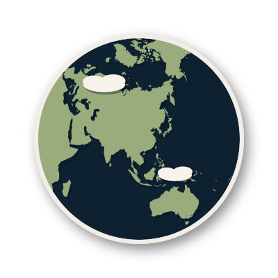
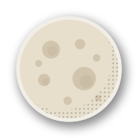

# 地球 / 月球贴纸资产与真实比例

用于「宇宙的尺度」页面后续导入。两个天体已拆成独立 SVG，地球陆地统一为单色，不再按国家分区填色。

## 1. 现实数据

| 天体 | 赤道直径 | 半径 | 相对地球直径 |
| --- | ---: | ---: | ---: |
| 地球 | 12,742 km | 6,371 km | 1 |
| 月球 | 3,474.8 km | 1,737.4 km | 0.2727 |

- 月球直径 = 地球直径 × **0.272743**（约 27.27%）
- 地球直径 = 月球直径 × **3.6665**
- 平均地月距离 384,400 km ≈ 30.17 个地球直径（本资产不按距离绘制）

## 2. 资产文件

| 文件 | viewBox | 球体半径 | 球体直径 | 球体占画布 |
| --- | --- | ---: | ---: | ---: |
| `assets/earth-sticker.svg` | 400 × 400 | 148 | 296 | 74% |
| `assets/moon-sticker.svg` | 200 × 200 | 74 | 148 | 74% |

两个文件的球体都占画布宽度的 74%，因此**整张 SVG 等比缩放**时：

```text
月球显示宽度 = 地球显示宽度 × 0.2727
```

预览：打开 `earth-moon.html`，页面按同一比例尺并排展示地球与月球（间距为艺术压缩，不是真实地月距离）。

常用尺寸：

| 地球 SVG 宽度 | 月球 SVG 宽度 | 地球球体 | 月球球体 |
| ---: | ---: | ---: | ---: |
| 320 px | 87 px | 237 px | 65 px |
| 400 px | 109 px | 296 px | 81 px |
| 600 px | 164 px | 444 px | 121 px |
| 800 px | 218 px | 592 px | 162 px |
| 1000 px | 273 px | 740 px | 202 px |

## 3. 导入方式

### 3.1 HTML 图片

```html


```

### 3.2 内联到现有 `index.html` 场景

现有场景以米为单位，地球半径 6,371,000 m，月球半径 1,737,400 m。按资产球体半径换算：

```text
地球组缩放 = 6,371,000 / 148 ≈ 43,047.30
月球组缩放 = 1,737,400 / 74  ≈ 23,478.38
```

```html
<g transform="translate(0 -0.85) scale(43047.30)">
  <image href="assets/earth-sticker.svg" x="-200" y="-200" width="400" height="400"/>
</g>
<g transform="translate(目标X 目标Y) scale(23478.38)">
  <image href="assets/moon-sticker.svg" x="-100" y="-100" width="200" height="200"/>
</g>
```

（`translate(0 -0.85)` 对应现有场景中地球圆心的位置；如果调整地球位置，同步修改该平移值。）

> 注意：真实地月距离 384,400,000 m 远超当前页面最大视野 42,000,000 m。若要同时看到地球和月球，必须压缩**间距**，但请保持上面的**尺寸比**不变，并在页面或文档中注明间距为艺术压缩。

### 3.3 只按球体尺寸缩放

如果后续裁切到球体本身，直接使用：

```text
月球球体直径 = 地球球体直径 × 0.272743
```

### 3.4 比例尺条

预览页中两个天体共用 41 km/px：

| 天体 | 球体显示直径 | 真实直径 | 比例 | 比例尺 |
| --- | ---: | ---: | ---: | --- |
| 地球 | 310.8 px | 12,742 km | 41.0 km/px | 0–10,000 km，244 px |
| 月球 | 84.7 px | 3,474.8 km | 41.0 km/px | 0–3,000 km，73 px |

```text
bar width = bar real size / subject real size × subject drawn diameter
```

比例尺条属于展示层，不写进可复用的 `earth-sticker.svg` / `moon-sticker.svg`。同一场景中的所有物体必须共用一个 km/px，标尺才可直接比较。

## 4. 风格约束

| 项目 | 值 |
| --- | --- |
| 海洋 | `#0e2131` |
| 陆地（单一颜色） | `#9aab7c` |
| 贴纸描边 | `#f1eee7` |
| 云 | `#f7f3ea` |
| 云朵投影 | `rgba(4,14,22,.35)` |
| 网点阴影 | `#04121a`，右下新月形 |
| 月球本体 | `#e7dfcc` |
| 月坑 | `#d2c5ae`，内阴影 `#c0b29a` |
| 地球描边宽度 | 6（viewBox 400） |
| 月球描边宽度 | 5（viewBox 200） |

- 地球陆地只有一个填充色，**不含中国、印度、澳大利亚等国家/地区色块**。
- 立体感来自：整块陆地的深色偏移投影 + 右下网点阴影 + 云朵投影。
- 月球独立文件，地球文件内不含月球、星星或金色点缀。
- 背景透明，可直接叠加在深色星空上。

## 5. 资产内嵌数据

两个 SVG 根节点都写入了便于脚本读取的属性：

```text
earth-sticker.svg: data-real-diameter-km="12742"  data-globe-diameter="296"
moon-sticker.svg:  data-real-diameter-km="3474.8" data-globe-diameter="148"
```

后续若做自动布局，可以直接读取 `data-globe-diameter` 计算比例，而不依赖 viewBox。
